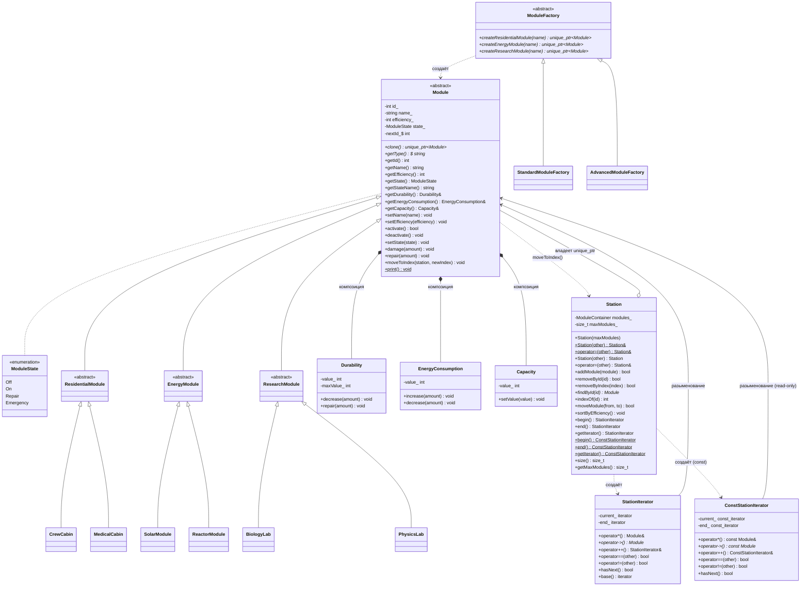

Selected Files Directory Structure:

└── ./
    └── lab1_version2
        ├── build
        │   └── CMakeFiles
        │       └── 4.3.1-msvc1
        │           └── CompilerIdCXX
        │               └── CMakeCXXCompilerId.cpp
        ├── include
        │   ├── attributes
        │   │   ├── Capacity.h
        │   │   ├── Durability.h
        │   │   └── EnergyConsumption.h
        │   ├── factories
        │   │   ├── AdvancedModuleFactory.h
        │   │   ├── ModuleFactory.h
        │   │   └── StandardModuleFactory.h
        │   ├── modules
        │   │   ├── BiologyLab.h
        │   │   ├── CrewCabin.h
        │   │   ├── EnergyModule.h
        │   │   ├── MedicalCabin.h
        │   │   ├── Module.h
        │   │   ├── PhysicsLab.h
        │   │   ├── ReactorModule.h
        │   │   ├── ResearchModule.h
        │   │   ├── ResidentialModule.h
        │   │   └── SolarModule.h
        │   └── station
        │       ├── Station.h
        │       └── StationIterator.h
        ├── src
        │   ├── attributes
        │   │   ├── Capacity.cpp
        │   │   ├── Durability.cpp
        │   │   └── EnergyConsumption.cpp
        │   ├── factories
        │   │   ├── AdvancedModuleFactory.cpp
        │   │   └── StandardModuleFactory.cpp
        │   ├── modules
        │   │   ├── BiologyLab.cpp
        │   │   ├── CrewCabin.cpp
        │   │   ├── EnergyModule.cpp
        │   │   ├── MedicalCabin.cpp
        │   │   ├── Module.cpp
        │   │   ├── PhysicsLab.cpp
        │   │   ├── ReactorModule.cpp
        │   │   ├── ResearchModule.cpp
        │   │   ├── ResidentialModule.cpp
        │   │   └── SolarModule.cpp
        │   ├── station
        │   │   ├── Station.cpp
        │   │   └── StationIterator.cpp
        │   └── main.cpp
        └── REPORT.md


--- lab1_version2/build/CMakeFiles/4.3.1-msvc1/CompilerIdCXX/CMakeCXXCompilerId.cpp ---

/* This source file must have a .cpp extension so that all C++ compilers
   recognize the extension without flags.  Borland does not know .cxx for
   example.  */
#ifndef __cplusplus
# error "A C compiler has been selected for C++."
#endif

#if !defined(__has_include)
/* If the compiler does not have __has_include, pretend the answer is
   always no.  */
#  define __has_include(x) 0
#endif


/* Version number components: V=Version, R=Revision, P=Patch
   Version date components:   YYYY=Year, MM=Month,   DD=Day  */

#if defined(__INTEL_COMPILER) || defined(__ICC)
# define COMPILER_ID "Intel"
# if defined(_MSC_VER)
#  define SIMULATE_ID "MSVC"
# endif
# if defined(__GNUC__)
#  define SIMULATE_ID "GNU"
# endif
  /* __INTEL_COMPILER = VRP prior to 2021, and then VVVV for 2021 and later,
     except that a few beta releases use the old format with V=2021.  */
# if __INTEL_COMPILER < 2021 || __INTEL_COMPILER == 202110 || __INTEL_COMPILER == 202111
#  define COMPILER_VERSION_MAJOR DEC(__INTEL_COMPILER/100)
#  define COMPILER_VERSION_MINOR DEC(__INTEL_COMPILER/10 % 10)
#  if defined(__INTEL_COMPILER_UPDATE)
#   define COMPILER_VERSION_PATCH DEC(__INTEL_COMPILER_UPDATE)
#  else
#   define COMPILER_VERSION_PATCH DEC(__INTEL_COMPILER   % 10)
#  endif
# else
#  define COMPILER_VERSION_MAJOR DEC(__INTEL_COMPILER)
#  define COMPILER_VERSION_MINOR DEC(__INTEL_COMPILER_UPDATE)
   /* The third version component from --version is an update index,
      but no macro is provided for it.  */
#  define COMPILER_VERSION_PATCH DEC(0)
# endif
# if defined(__INTEL_COMPILER_BUILD_DATE)
   /* __INTEL_COMPILER_BUILD_DATE = YYYYMMDD */
#  define COMPILER_VERSION_TWEAK DEC(__INTEL_COMPILER_BUILD_DATE)
# endif
# if defined(_MSC_VER)
   /* _MSC_VER = VVRR */
#  define SIMULATE_VERSION_MAJOR DEC(_MSC_VER / 100)
#  define SIMULATE_VERSION_MINOR DEC(_MSC_VER % 100)
# endif
# if defined(__GNUC__)
#  define SIMULATE_VERSION_MAJOR DEC(__GNUC__)
# elif defined(__GNUG__)
#  define SIMULATE_VERSION_MAJOR DEC(__GNUG__)
# endif
# if defined(__GNUC_MINOR__)
#  define SIMULATE_VERSION_MINOR DEC(__GNUC_MINOR__)
# endif
# if defined(__GNUC_PATCHLEVEL__)
#  define SIMULATE_VERSION_PATCH DEC(__GNUC_PATCHLEVEL__)
# endif

#elif (defined(__clang__) && defined(__INTEL_CLANG_COMPILER)) || defined(__INTEL_LLVM_COMPILER)
# define COMPILER_ID "IntelLLVM"
#if defined(_MSC_VER)
# define SIMULATE_ID "MSVC"
#endif
#if defined(__GNUC__)
# define SIMULATE_ID "GNU"
#endif
/* __INTEL_LLVM_COMPILER = VVVVRP prior to 2021.2.0, VVVVRRPP for 2021.2.0 and
 * later.  Look for 6 digit vs. 8 digit version number to decide encoding.
 * VVVV is no smaller than the current year when a version is released.
 */
#if __INTEL_LLVM_COMPILER < 1000000L
# define COMPILER_VERSION_MAJOR DEC(__INTEL_LLVM_COMPILER/100)
# define COMPILER_VERSION_MINOR DEC(__INTEL_LLVM_COMPILER/10 % 10)
# define COMPILER_VERSION_PATCH DEC(__INTEL_LLVM_COMPILER    % 10)
#else
# define COMPILER_VERSION_MAJOR DEC(__INTEL_LLVM_COMPILER/10000)
# define COMPILER_VERSION_MINOR DEC(__INTEL_LLVM_COMPILER/100 % 100)
# define COMPILER_VERSION_PATCH DEC(__INTEL_LLVM_COMPILER     % 100)
#endif
#if defined(_MSC_VER)
  /* _MSC_VER = VVRR */
# define SIMULATE_VERSION_MAJOR DEC(_MSC_VER / 100)
# define SIMULATE_VERSION_MINOR DEC(_MSC_VER % 100)
#endif
#if defined(__GNUC__)
# define SIMULATE_VERSION_MAJOR DEC(__GNUC__)
#elif defined(__GNUG__)
# define SIMULATE_VERSION_MAJOR DEC(__GNUG__)
#endif
#if defined(__GNUC_MINOR__)
# define SIMULATE_VERSION_MINOR DEC(__GNUC_MINOR__)
#endif
#if defined(__GNUC_PATCHLEVEL__)
# define SIMULATE_VERSION_PATCH DEC(__GNUC_PATCHLEVEL__)
#endif

#elif defined(__PATHCC__)
# define COMPILER_ID "PathScale"
# define COMPILER_VERSION_MAJOR DEC(__PATHCC__)
# define COMPILER_VERSION_MINOR DEC(__PATHCC_MINOR__)
# if defined(__PATHCC_PATCHLEVEL__)
#  define COMPILER_VERSION_PATCH DEC(__PATHCC_PATCHLEVEL__)
# endif

#elif defined(__BORLANDC__) && defined(__CODEGEARC_VERSION__)
# define COMPILER_ID "Embarcadero"
# define COMPILER_VERSION_MAJOR HEX(__CODEGEARC_VERSION__>>24 & 0x00FF)
# define COMPILER_VERSION_MINOR HEX(__CODEGEARC_VERSION__>>16 & 0x00FF)
# define COMPILER_VERSION_PATCH DEC(__CODEGEARC_VERSION__     & 0xFFFF)

#elif defined(__BORLANDC__)
# define COMPILER_ID "Borland"
  /* __BORLANDC__ = 0xVRR */
# define COMPILER_VERSION_MAJOR HEX(__BORLANDC__>>8)
# define COMPILER_VERSION_MINOR HEX(__BORLANDC__ & 0xFF)

#elif defined(__WATCOMC__) && __WATCOMC__ < 1200
# define COMPILER_ID "Watcom"
   /* __WATCOMC__ = VVRR */
# define COMPILER_VERSION_MAJOR DEC(__WATCOMC__ / 100)
# define COMPILER_VERSION_MINOR DEC((__WATCOMC__ / 10) % 10)
# if (__WATCOMC__ % 10) > 0
#  define COMPILER_VERSION_PATCH DEC(__WATCOMC__ % 10)
# endif

#elif defined(__WATCOMC__)
# define COMPILER_ID "OpenWatcom"
   /* __WATCOMC__ = VVRP + 1100 */
# define COMPILER_VERSION_MAJOR DEC((__WATCOMC__ - 1100) / 100)
# define COMPILER_VERSION_MINOR DEC((__WATCOMC__ / 10) % 10)
# if (__WATCOMC__ % 10) > 0
#  define COMPILER_VERSION_PATCH DEC(__WATCOMC__ % 10)
# endif

#elif defined(__SUNPRO_CC)
# define COMPILER_ID "SunPro"
# if __SUNPRO_CC >= 0x5100
   /* __SUNPRO_CC = 0xVRRP */
#  define COMPILER_VERSION_MAJOR HEX(__SUNPRO_CC>>12)
#  define COMPILER_VERSION_MINOR HEX(__SUNPRO_CC>>4 & 0xFF)
#  define COMPILER_VERSION_PATCH HEX(__SUNPRO_CC    & 0xF)
# else
   /* __SUNPRO_CC = 0xVRP */
#  define COMPILER_VERSION_MAJOR HEX(__SUNPRO_CC>>8)
#  define COMPILER_VERSION_MINOR HEX(__SUNPRO_CC>>4 & 0xF)
#  define COMPILER_VERSION_PATCH HEX(__SUNPRO_CC    & 0xF)
# endif

#elif defined(__HP_aCC)
# define COMPILER_ID "HP"
  /* __HP_aCC = VVRRPP */
# define COMPILER_VERSION_MAJOR DEC(__HP_aCC/10000)
# define COMPILER_VERSION_MINOR DEC(__HP_aCC/100 % 100)
# define COMPILER_VERSION_PATCH DEC(__HP_aCC     % 100)

#elif defined(__DECCXX)
# define COMPILER_ID "Compaq"
  /* __DECCXX_VER = VVRRTPPPP */
# define COMPILER_VERSION_MAJOR DEC(__DECCXX_VER/10000000)
# define COMPILER_VERSION_MINOR DEC(__DECCXX_VER/100000  % 100)
# define COMPILER_VERSION_PATCH DEC(__DECCXX_VER         % 10000)

#elif defined(__IBMCPP__) && defined(__COMPILER_VER__)
# define COMPILER_ID "zOS"
  /* __IBMCPP__ = VRP */
# define COMPILER_VERSION_MAJOR DEC(__IBMCPP__/100)
# define COMPILER_VERSION_MINOR DEC(__IBMCPP__/10 % 10)
# define COMPILER_VERSION_PATCH DEC(__IBMCPP__    % 10)

#elif defined(__open_xl__) && defined(__clang__)
# define COMPILER_ID "IBMClang"
# define COMPILER_VERSION_MAJOR DEC(__open_xl_version__)
# define COMPILER_VERSION_MINOR DEC(__open_xl_release__)
# define COMPILER_VERSION_PATCH DEC(__open_xl_modification__)
# define COMPILER_VERSION_TWEAK DEC(__open_xl_ptf_fix_level__)
# define COMPILER_VERSION_INTERNAL_STR  __clang_version__


#elif defined(__ibmxl__) && defined(__clang__)
# define COMPILER_ID "XLClang"
# define COMPILER_VERSION_MAJOR DEC(__ibmxl_version__)
# define COMPILER_VERSION_MINOR DEC(__ibmxl_release__)
# define COMPILER_VERSION_PATCH DEC(__ibmxl_modification__)
# define COMPILER_VERSION_TWEAK DEC(__ibmxl_ptf_fix_level__)


#elif defined(__IBMCPP__) && !defined(__COMPILER_VER__) && __IBMCPP__ >= 800
# define COMPILER_ID "XL"
  /* __IBMCPP__ = VRP */
# define COMPILER_VERSION_MAJOR DEC(__IBMCPP__/100)
# define COMPILER_VERSION_MINOR DEC(__IBMCPP__/10 % 10)
# define COMPILER_VERSION_PATCH DEC(__IBMCPP__    % 10)

#elif defined(__IBMCPP__) && !defined(__COMPILER_VER__) && __IBMCPP__ < 800
# define COMPILER_ID "VisualAge"
  /* __IBMCPP__ = VRP */
# define COMPILER_VERSION_MAJOR DEC(__IBMCPP__/100)
# define COMPILER_VERSION_MINOR DEC(__IBMCPP__/10 % 10)
# define COMPILER_VERSION_PATCH DEC(__IBMCPP__    % 10)

#elif defined(__NVCOMPILER)
# define COMPILER_ID "NVHPC"
# define COMPILER_VERSION_MAJOR DEC(__NVCOMPILER_MAJOR__)
# define COMPILER_VERSION_MINOR DEC(__NVCOMPILER_MINOR__)
# if defined(__NVCOMPILER_PATCHLEVEL__)
#  define COMPILER_VERSION_PATCH DEC(__NVCOMPILER_PATCHLEVEL__)
# endif

#elif defined(__PGI)
# define COMPILER_ID "PGI"
# define COMPILER_VERSION_MAJOR DEC(__PGIC__)
# define COMPILER_VERSION_MINOR DEC(__PGIC_MINOR__)
# if defined(__PGIC_PATCHLEVEL__)
#  define COMPILER_VERSION_PATCH DEC(__PGIC_PATCHLEVEL__)
# endif

#elif defined(__clang__) && defined(__cray__)
# define COMPILER_ID "CrayClang"
# define COMPILER_VERSION_MAJOR DEC(__cray_major__)
# define COMPILER_VERSION_MINOR DEC(__cray_minor__)
# define COMPILER_VERSION_PATCH DEC(__cray_patchlevel__)
# define COMPILER_VERSION_INTERNAL_STR __clang_version__


#elif defined(_CRAYC)
# define COMPILER_ID "Cray"
# define COMPILER_VERSION_MAJOR DEC(_RELEASE_MAJOR)
# define COMPILER_VERSION_MINOR DEC(_RELEASE_MINOR)

#elif defined(__TI_COMPILER_VERSION__)
# define COMPILER_ID "TI"
  /* __TI_COMPILER_VERSION__ = VVVRRRPPP */
# define COMPILER_VERSION_MAJOR DEC(__TI_COMPILER_VERSION__/1000000)
# define COMPILER_VERSION_MINOR DEC(__TI_COMPILER_VERSION__/1000   % 1000)
# define COMPILER_VERSION_PATCH DEC(__TI_COMPILER_VERSION__        % 1000)

#elif defined(__CLANG_FUJITSU)
# define COMPILER_ID "FujitsuClang"
# define COMPILER_VERSION_MAJOR DEC(__FCC_major__)
# define COMPILER_VERSION_MINOR DEC(__FCC_minor__)
# define COMPILER_VERSION_PATCH DEC(__FCC_patchlevel__)
# define COMPILER_VERSION_INTERNAL_STR __clang_version__


#elif defined(__FUJITSU)
# define COMPILER_ID "Fujitsu"
# if defined(__FCC_version__)
#   define COMPILER_VERSION __FCC_version__
# elif defined(__FCC_major__)
#   define COMPILER_VERSION_MAJOR DEC(__FCC_major__)
#   define COMPILER_VERSION_MINOR DEC(__FCC_minor__)
#   define COMPILER_VERSION_PATCH DEC(__FCC_patchlevel__)
# endif
# if defined(__fcc_version)
#   define COMPILER_VERSION_INTERNAL DEC(__fcc_version)
# elif defined(__FCC_VERSION)
#   define COMPILER_VERSION_INTERNAL DEC(__FCC_VERSION)
# endif


#elif defined(__ghs__)
# define COMPILER_ID "GHS"
/* __GHS_VERSION_NUMBER = VVVVRP */
# ifdef __GHS_VERSION_NUMBER
# define COMPILER_VERSION_MAJOR DEC(__GHS_VERSION_NUMBER / 100)
# define COMPILER_VERSION_MINOR DEC(__GHS_VERSION_NUMBER / 10 % 10)
# define COMPILER_VERSION_PATCH DEC(__GHS_VERSION_NUMBER      % 10)
# endif

#elif defined(__TASKING__)
# define COMPILER_ID "Tasking"
  # define COMPILER_VERSION_MAJOR DEC(__VERSION__/1000)
  # define COMPILER_VERSION_MINOR DEC(__VERSION__ % 100)
# define COMPILER_VERSION_INTERNAL DEC(__VERSION__)

#elif defined(__ORANGEC__)
# define COMPILER_ID "OrangeC"
# define COMPILER_VERSION_MAJOR DEC(__ORANGEC_MAJOR__)
# define COMPILER_VERSION_MINOR DEC(__ORANGEC_MINOR__)
# define COMPILER_VERSION_PATCH DEC(__ORANGEC_PATCHLEVEL__)

#elif defined(__RENESAS__)
# define COMPILER_ID "Renesas"
/* __RENESAS_VERSION__ = 0xVVRRPP00 */
# define COMPILER_VERSION_MAJOR HEX(__RENESAS_VERSION__ >> 24 & 0xFF)
# define COMPILER_VERSION_MINOR HEX(__RENESAS_VERSION__ >> 16 & 0xFF)
# define COMPILER_VERSION_PATCH HEX(__RENESAS_VERSION__ >> 8  & 0xFF)

#elif defined(__SCO_VERSION__)
# define COMPILER_ID "SCO"

#elif defined(__ARMCC_VERSION) && !defined(__clang__)
# define COMPILER_ID "ARMCC"
#if __ARMCC_VERSION >= 1000000
  /* __ARMCC_VERSION = VRRPPPP */
  # define COMPILER_VERSION_MAJOR DEC(__ARMCC_VERSION/1000000)
  # define COMPILER_VERSION_MINOR DEC(__ARMCC_VERSION/10000 % 100)
  # define COMPILER_VERSION_PATCH DEC(__ARMCC_VERSION     % 10000)
#else
  /* __ARMCC_VERSION = VRPPPP */
  # define COMPILER_VERSION_MAJOR DEC(__ARMCC_VERSION/100000)
  # define COMPILER_VERSION_MINOR DEC(__ARMCC_VERSION/10000 % 10)
  # define COMPILER_VERSION_PATCH DEC(__ARMCC_VERSION    % 10000)
#endif


#elif defined(__clang__) && defined(__apple_build_version__)
# define COMPILER_ID "AppleClang"
# if defined(_MSC_VER)
#  define SIMULATE_ID "MSVC"
# endif
# define COMPILER_VERSION_MAJOR DEC(__clang_major__)
# define COMPILER_VERSION_MINOR DEC(__clang_minor__)
# define COMPILER_VERSION_PATCH DEC(__clang_patchlevel__)
# if defined(_MSC_VER)
   /* _MSC_VER = VVRR */
#  define SIMULATE_VERSION_MAJOR DEC(_MSC_VER / 100)
#  define SIMULATE_VERSION_MINOR DEC(_MSC_VER % 100)
# endif
# define COMPILER_VERSION_TWEAK DEC(__apple_build_version__)

#elif defined(__clang__) && defined(__ARMCOMPILER_VERSION)
# define COMPILER_ID "ARMClang"
  # define COMPILER_VERSION_MAJOR DEC(__ARMCOMPILER_VERSION/1000000)
  # define COMPILER_VERSION_MINOR DEC(__ARMCOMPILER_VERSION/10000 % 100)
  # define COMPILER_VERSION_PATCH DEC(__ARMCOMPILER_VERSION/100   % 100)
# define COMPILER_VERSION_INTERNAL DEC(__ARMCOMPILER_VERSION)

#elif defined(__clang__) && defined(__ti__)
# define COMPILER_ID "TIClang"
  # define COMPILER_VERSION_MAJOR DEC(__ti_major__)
  # define COMPILER_VERSION_MINOR DEC(__ti_minor__)
  # define COMPILER_VERSION_PATCH DEC(__ti_patchlevel__)
# define COMPILER_VERSION_INTERNAL DEC(__ti_version__)

#elif defined(__clang__)
# define COMPILER_ID "Clang"
# if defined(_MSC_VER)
#  define SIMULATE_ID "MSVC"
# endif
# define COMPILER_VERSION_MAJOR DEC(__clang_major__)
# define COMPILER_VERSION_MINOR DEC(__clang_minor__)
# define COMPILER_VERSION_PATCH DEC(__clang_patchlevel__)
# if defined(_MSC_VER)
   /* _MSC_VER = VVRR */
#  define SIMULATE_VERSION_MAJOR DEC(_MSC_VER / 100)
#  define SIMULATE_VERSION_MINOR DEC(_MSC_VER % 100)
# endif

#elif defined(__LCC__) && (defined(__GNUC__) || defined(__GNUG__) || defined(__MCST__))
# define COMPILER_ID "LCC"
# define COMPILER_VERSION_MAJOR DEC(__LCC__ / 100)
# define COMPILER_VERSION_MINOR DEC(__LCC__ % 100)
# if defined(__LCC_MINOR__)
#  define COMPILER_VERSION_PATCH DEC(__LCC_MINOR__)
# endif
# if defined(__GNUC__) && defined(__GNUC_MINOR__)
#  define SIMULATE_ID "GNU"
#  define SIMULATE_VERSION_MAJOR DEC(__GNUC__)
#  define SIMULATE_VERSION_MINOR DEC(__GNUC_MINOR__)
#  if defined(__GNUC_PATCHLEVEL__)
#   define SIMULATE_VERSION_PATCH DEC(__GNUC_PATCHLEVEL__)
#  endif
# endif

#elif defined(__GNUC__) || defined(__GNUG__)
# define COMPILER_ID "GNU"
# if defined(__GNUC__)
#  define COMPILER_VERSION_MAJOR DEC(__GNUC__)
# else
#  define COMPILER_VERSION_MAJOR DEC(__GNUG__)
# endif
# if defined(__GNUC_MINOR__)
#  define COMPILER_VERSION_MINOR DEC(__GNUC_MINOR__)
# endif
# if defined(__GNUC_PATCHLEVEL__)
#  define COMPILER_VERSION_PATCH DEC(__GNUC_PATCHLEVEL__)
# endif

#elif defined(_MSC_VER)
# define COMPILER_ID "MSVC"
  /* _MSC_VER = VVRR */
# define COMPILER_VERSION_MAJOR DEC(_MSC_VER / 100)
# define COMPILER_VERSION_MINOR DEC(_MSC_VER % 100)
# if defined(_MSC_FULL_VER)
#  if _MSC_VER >= 1400
    /* _MSC_FULL_VER = VVRRPPPPP */
#   define COMPILER_VERSION_PATCH DEC(_MSC_FULL_VER % 100000)
#  else
    /* _MSC_FULL_VER = VVRRPPPP */
#   define COMPILER_VERSION_PATCH DEC(_MSC_FULL_VER % 10000)
#  endif
# endif
# if defined(_MSC_BUILD)
#  define COMPILER_VERSION_TWEAK DEC(_MSC_BUILD)
# endif

#elif defined(_ADI_COMPILER)
# define COMPILER_ID "ADSP"
#if defined(__VERSIONNUM__)
  /* __VERSIONNUM__ = 0xVVRRPPTT */
#  define COMPILER_VERSION_MAJOR DEC(__VERSIONNUM__ >> 24 & 0xFF)
#  define COMPILER_VERSION_MINOR DEC(__VERSIONNUM__ >> 16 & 0xFF)
#  define COMPILER_VERSION_PATCH DEC(__VERSIONNUM__ >> 8 & 0xFF)
#  define COMPILER_VERSION_TWEAK DEC(__VERSIONNUM__ & 0xFF)
#endif

#elif defined(__IAR_SYSTEMS_ICC__) || defined(__IAR_SYSTEMS_ICC)
# define COMPILER_ID "IAR"
# if defined(__VER__) && defined(__ICCARM__)
#  define COMPILER_VERSION_MAJOR DEC((__VER__) / 1000000)
#  define COMPILER_VERSION_MINOR DEC(((__VER__) / 1000) % 1000)
#  define COMPILER_VERSION_PATCH DEC((__VER__) % 1000)
#  define COMPILER_VERSION_INTERNAL DEC(__IAR_SYSTEMS_ICC__)
# elif defined(__VER__) && (defined(__ICCAVR__) || defined(__ICCRX__) || defined(__ICCRH850__) || defined(__ICCRL78__) || defined(__ICC430__) || defined(__ICCRISCV__) || defined(__ICCV850__) || defined(__ICC8051__) || defined(__ICCSTM8__))
#  define COMPILER_VERSION_MAJOR DEC((__VER__) / 100)
#  define COMPILER_VERSION_MINOR DEC((__VER__) - (((__VER__) / 100)*100))
#  define COMPILER_VERSION_PATCH DEC(__SUBVERSION__)
#  define COMPILER_VERSION_INTERNAL DEC(__IAR_SYSTEMS_ICC__)
# endif

#elif defined(__DCC__) && defined(_DIAB_TOOL)
# define COMPILER_ID "Diab"
  # define COMPILER_VERSION_MAJOR DEC(__VERSION_MAJOR_NUMBER__)
  # define COMPILER_VERSION_MINOR DEC(__VERSION_MINOR_NUMBER__)
  # define COMPILER_VERSION_PATCH DEC(__VERSION_ARCH_FEATURE_NUMBER__)
  # define COMPILER_VERSION_TWEAK DEC(__VERSION_BUG_FIX_NUMBER__)


/* These compilers are either not known or too old to define an
  identification macro.  Try to identify the platform and guess that
  it is the native compiler.  */
#elif defined(__hpux) || defined(__hpua)
# define COMPILER_ID "HP"

#else /* unknown compiler */
# define COMPILER_ID ""
#endif

/* Construct the string literal in pieces to prevent the source from
   getting matched.  Store it in a pointer rather than an array
   because some compilers will just produce instructions to fill the
   array rather than assigning a pointer to a static array.  */
char const* info_compiler = "INFO" ":" "compiler[" COMPILER_ID "]";
#ifdef SIMULATE_ID
char const* info_simulate = "INFO" ":" "simulate[" SIMULATE_ID "]";
#endif

#ifdef __QNXNTO__
char const* qnxnto = "INFO" ":" "qnxnto[]";
#endif

#if defined(__CRAYXT_COMPUTE_LINUX_TARGET)
char const *info_cray = "INFO" ":" "compiler_wrapper[CrayPrgEnv]";
#endif

#define STRINGIFY_HELPER(X) #X
#define STRINGIFY(X) STRINGIFY_HELPER(X)

/* Identify known platforms by name.  */
#if defined(__linux) || defined(__linux__) || defined(linux)
# define PLATFORM_ID "Linux"

#elif defined(__MSYS__)
# define PLATFORM_ID "MSYS"

#elif defined(__CYGWIN__)
# define PLATFORM_ID "Cygwin"

#elif defined(__MINGW32__)
# define PLATFORM_ID "MinGW"

#elif defined(__APPLE__)
# define PLATFORM_ID "Darwin"

#elif defined(_WIN32) || defined(__WIN32__) || defined(WIN32)
# define PLATFORM_ID "Windows"

#elif defined(__FreeBSD__) || defined(__FreeBSD)
# define PLATFORM_ID "FreeBSD"

#elif defined(__NetBSD__) || defined(__NetBSD)
# define PLATFORM_ID "NetBSD"

#elif defined(__OpenBSD__) || defined(__OPENBSD)
# define PLATFORM_ID "OpenBSD"

#elif defined(__sun) || defined(sun)
# define PLATFORM_ID "SunOS"

#elif defined(_AIX) || defined(__AIX) || defined(__AIX__) || defined(__aix) || defined(__aix__)
# define PLATFORM_ID "AIX"

#elif defined(__hpux) || defined(__hpux__)
# define PLATFORM_ID "HP-UX"

#elif defined(__HAIKU__)
# define PLATFORM_ID "Haiku"

#elif defined(__BeOS) || defined(__BEOS__) || defined(_BEOS)
# define PLATFORM_ID "BeOS"

#elif defined(__QNX__) || defined(__QNXNTO__)
# define PLATFORM_ID "QNX"

#elif defined(__tru64) || defined(_tru64) || defined(__TRU64__)
# define PLATFORM_ID "Tru64"

#elif defined(__riscos) || defined(__riscos__)
# define PLATFORM_ID "RISCos"

#elif defined(__sinix) || defined(__sinix__) || defined(__SINIX__)
# define PLATFORM_ID "SINIX"

#elif defined(__UNIX_SV__)
# define PLATFORM_ID "UNIX_SV"

#elif defined(__bsdos__)
# define PLATFORM_ID "BSDOS"

#elif defined(_MPRAS) || defined(MPRAS)
# define PLATFORM_ID "MP-RAS"

#elif defined(__osf) || defined(__osf__)
# define PLATFORM_ID "OSF1"

#elif defined(_SCO_SV) || defined(SCO_SV) || defined(sco_sv)
# define PLATFORM_ID "SCO_SV"

#elif defined(__ultrix) || defined(__ultrix__) || defined(_ULTRIX)
# define PLATFORM_ID "ULTRIX"

#elif defined(__XENIX__) || defined(_XENIX) || defined(XENIX)
# define PLATFORM_ID "Xenix"

#elif defined(__WATCOMC__)
# if defined(__LINUX__)
#  define PLATFORM_ID "Linux"

# elif defined(__DOS__)
#  define PLATFORM_ID "DOS"

# elif defined(__OS2__)
#  define PLATFORM_ID "OS2"

# elif defined(__WINDOWS__)
#  define PLATFORM_ID "Windows3x"

# elif defined(__VXWORKS__)
#  define PLATFORM_ID "VxWorks"

# else /* unknown platform */
#  define PLATFORM_ID
# endif

#elif defined(__INTEGRITY)
# if defined(INT_178B)
#  define PLATFORM_ID "Integrity178"

# else /* regular Integrity */
#  define PLATFORM_ID "Integrity"
# endif

# elif defined(_ADI_COMPILER)
#  define PLATFORM_ID "ADSP"

#else /* unknown platform */
# define PLATFORM_ID

#endif

/* For windows compilers MSVC and Intel we can determine
   the architecture of the compiler being used.  This is because
   the compilers do not have flags that can change the architecture,
   but rather depend on which compiler is being used
*/
#if defined(_WIN32) && defined(_MSC_VER)
# if defined(_M_IA64)
#  define ARCHITECTURE_ID "IA64"

# elif defined(_M_ARM64EC)
#  define ARCHITECTURE_ID "ARM64EC"

# elif defined(_M_X64) || defined(_M_AMD64)
#  define ARCHITECTURE_ID "x64"

# elif defined(_M_IX86)
#  define ARCHITECTURE_ID "X86"

# elif defined(_M_ARM64)
#  define ARCHITECTURE_ID "ARM64"

# elif defined(_M_ARM)
#  if _M_ARM == 4
#   define ARCHITECTURE_ID "ARMV4I"
#  elif _M_ARM == 5
#   define ARCHITECTURE_ID "ARMV5I"
#  else
#   define ARCHITECTURE_ID "ARMV" STRINGIFY(_M_ARM)
#  endif

# elif defined(_M_MIPS)
#  define ARCHITECTURE_ID "MIPS"

# elif defined(_M_SH)
#  define ARCHITECTURE_ID "SHx"

# else /* unknown architecture */
#  define ARCHITECTURE_ID ""
# endif

#elif defined(__WATCOMC__)
# if defined(_M_I86)
#  define ARCHITECTURE_ID "I86"

# elif defined(_M_IX86)
#  define ARCHITECTURE_ID "X86"

# else /* unknown architecture */
#  define ARCHITECTURE_ID ""
# endif

#elif defined(__IAR_SYSTEMS_ICC__) || defined(__IAR_SYSTEMS_ICC)
# if defined(__ICCARM__)
#  define ARCHITECTURE_ID "ARM"

# elif defined(__ICCRX__)
#  define ARCHITECTURE_ID "RX"

# elif defined(__ICCRH850__)
#  define ARCHITECTURE_ID "RH850"

# elif defined(__ICCRL78__)
#  define ARCHITECTURE_ID "RL78"

# elif defined(__ICCRISCV__)
#  define ARCHITECTURE_ID "RISCV"

# elif defined(__ICCAVR__)
#  define ARCHITECTURE_ID "AVR"

# elif defined(__ICC430__)
#  define ARCHITECTURE_ID "MSP430"

# elif defined(__ICCV850__)
#  define ARCHITECTURE_ID "V850"

# elif defined(__ICC8051__)
#  define ARCHITECTURE_ID "8051"

# elif defined(__ICCSTM8__)
#  define ARCHITECTURE_ID "STM8"

# else /* unknown architecture */
#  define ARCHITECTURE_ID ""
# endif

#elif defined(__ghs__)
# if defined(__PPC64__)
#  define ARCHITECTURE_ID "PPC64"

# elif defined(__ppc__)
#  define ARCHITECTURE_ID "PPC"

# elif defined(__ARM__)
#  define ARCHITECTURE_ID "ARM"

# elif defined(__x86_64__)
#  define ARCHITECTURE_ID "x64"

# elif defined(__i386__)
#  define ARCHITECTURE_ID "X86"

# else /* unknown architecture */
#  define ARCHITECTURE_ID ""
# endif

#elif defined(__clang__) && defined(__ti__)
# if defined(__ARM_ARCH)
#  define ARCHITECTURE_ID "ARM"

# else /* unknown architecture */
#  define ARCHITECTURE_ID ""
# endif

#elif defined(__TI_COMPILER_VERSION__)
# if defined(__TI_ARM__)
#  define ARCHITECTURE_ID "ARM"

# elif defined(__MSP430__)
#  define ARCHITECTURE_ID "MSP430"

# elif defined(__TMS320C28XX__)
#  define ARCHITECTURE_ID "TMS320C28x"

# elif defined(__TMS320C6X__) || defined(_TMS320C6X)
#  define ARCHITECTURE_ID "TMS320C6x"

# else /* unknown architecture */
#  define ARCHITECTURE_ID ""
# endif

# elif defined(__ADSPSHARC__)
#  define ARCHITECTURE_ID "SHARC"

# elif defined(__ADSPBLACKFIN__)
#  define ARCHITECTURE_ID "Blackfin"

#elif defined(__TASKING__)

# if defined(__CTC__) || defined(__CPTC__)
#  define ARCHITECTURE_ID "TriCore"

# elif defined(__CMCS__)
#  define ARCHITECTURE_ID "MCS"

# elif defined(__CARM__) || defined(__CPARM__)
#  define ARCHITECTURE_ID "ARM"

# elif defined(__CARC__)
#  define ARCHITECTURE_ID "ARC"

# elif defined(__C51__)
#  define ARCHITECTURE_ID "8051"

# elif defined(__CPCP__)
#  define ARCHITECTURE_ID "PCP"

# else
#  define ARCHITECTURE_ID ""
# endif

#elif defined(__RENESAS__)
# if defined(__CCRX__)
#  define ARCHITECTURE_ID "RX"

# elif defined(__CCRL__)
#  define ARCHITECTURE_ID "RL78"

# elif defined(__CCRH__)
#  define ARCHITECTURE_ID "RH850"

# else
#  define ARCHITECTURE_ID ""
# endif

#else
#  define ARCHITECTURE_ID
#endif

/* Convert integer to decimal digit literals.  */
#define DEC(n)                   \
  ('0' + (((n) / 10000000)%10)), \
  ('0' + (((n) / 1000000)%10)),  \
  ('0' + (((n) / 100000)%10)),   \
  ('0' + (((n) / 10000)%10)),    \
  ('0' + (((n) / 1000)%10)),     \
  ('0' + (((n) / 100)%10)),      \
  ('0' + (((n) / 10)%10)),       \
  ('0' +  ((n) % 10))

/* Convert integer to hex digit literals.  */
#define HEX(n)             \
  ('0' + ((n)>>28 & 0xF)), \
  ('0' + ((n)>>24 & 0xF)), \
  ('0' + ((n)>>20 & 0xF)), \
  ('0' + ((n)>>16 & 0xF)), \
  ('0' + ((n)>>12 & 0xF)), \
  ('0' + ((n)>>8  & 0xF)), \
  ('0' + ((n)>>4  & 0xF)), \
  ('0' + ((n)     & 0xF))

/* Construct a string literal encoding the version number. */
#ifdef COMPILER_VERSION
char const* info_version = "INFO" ":" "compiler_version[" COMPILER_VERSION "]";

/* Construct a string literal encoding the version number components. */
#elif defined(COMPILER_VERSION_MAJOR)
char const info_version[] = {
  'I', 'N', 'F', 'O', ':',
  'c','o','m','p','i','l','e','r','_','v','e','r','s','i','o','n','[',
  COMPILER_VERSION_MAJOR,
# ifdef COMPILER_VERSION_MINOR
  '.', COMPILER_VERSION_MINOR,
#  ifdef COMPILER_VERSION_PATCH
   '.', COMPILER_VERSION_PATCH,
#   ifdef COMPILER_VERSION_TWEAK
    '.', COMPILER_VERSION_TWEAK,
#   endif
#  endif
# endif
  ']','\0'};
#endif

/* Construct a string literal encoding the internal version number. */
#ifdef COMPILER_VERSION_INTERNAL
char const info_version_internal[] = {
  'I', 'N', 'F', 'O', ':',
  'c','o','m','p','i','l','e','r','_','v','e','r','s','i','o','n','_',
  'i','n','t','e','r','n','a','l','[',
  COMPILER_VERSION_INTERNAL,']','\0'};
#elif defined(COMPILER_VERSION_INTERNAL_STR)
char const* info_version_internal = "INFO" ":" "compiler_version_internal[" COMPILER_VERSION_INTERNAL_STR "]";
#endif

/* Construct a string literal encoding the version number components. */
#ifdef SIMULATE_VERSION_MAJOR
char const info_simulate_version[] = {
  'I', 'N', 'F', 'O', ':',
  's','i','m','u','l','a','t','e','_','v','e','r','s','i','o','n','[',
  SIMULATE_VERSION_MAJOR,
# ifdef SIMULATE_VERSION_MINOR
  '.', SIMULATE_VERSION_MINOR,
#  ifdef SIMULATE_VERSION_PATCH
   '.', SIMULATE_VERSION_PATCH,
#   ifdef SIMULATE_VERSION_TWEAK
    '.', SIMULATE_VERSION_TWEAK,
#   endif
#  endif
# endif
  ']','\0'};
#endif

/* Construct the string literal in pieces to prevent the source from
   getting matched.  Store it in a pointer rather than an array
   because some compilers will just produce instructions to fill the
   array rather than assigning a pointer to a static array.  */
char const* info_platform = "INFO" ":" "platform[" PLATFORM_ID "]";
char const* info_arch = "INFO" ":" "arch[" ARCHITECTURE_ID "]";


#define CXX_STD_98 199711L
#define CXX_STD_11 201103L
#define CXX_STD_14 201402L
#define CXX_STD_17 201703L
#define CXX_STD_20 202002L
#define CXX_STD_23 202302L

#if defined(__INTEL_COMPILER) && defined(_MSVC_LANG)
#  if _MSVC_LANG > CXX_STD_17
#    define CXX_STD _MSVC_LANG
#  elif _MSVC_LANG == CXX_STD_17 && defined(__cpp_aggregate_paren_init)
#    define CXX_STD CXX_STD_20
#  elif _MSVC_LANG > CXX_STD_14 && __cplusplus > CXX_STD_17
#    define CXX_STD CXX_STD_20
#  elif _MSVC_LANG > CXX_STD_14
#    define CXX_STD CXX_STD_17
#  elif defined(__INTEL_CXX11_MODE__) && defined(__cpp_aggregate_nsdmi)
#    define CXX_STD CXX_STD_14
#  elif defined(__INTEL_CXX11_MODE__)
#    define CXX_STD CXX_STD_11
#  else
#    define CXX_STD CXX_STD_98
#  endif
#elif defined(_MSC_VER) && defined(_MSVC_LANG)
#  if _MSVC_LANG > __cplusplus
#    define CXX_STD _MSVC_LANG
#  else
#    define CXX_STD __cplusplus
#  endif
#elif defined(__NVCOMPILER)
#  if __cplusplus == CXX_STD_17 && defined(__cpp_aggregate_paren_init)
#    define CXX_STD CXX_STD_20
#  else
#    define CXX_STD __cplusplus
#  endif
#elif defined(__INTEL_COMPILER) || defined(__PGI)
#  if __cplusplus == CXX_STD_11 && defined(__cpp_namespace_attributes)
#    define CXX_STD CXX_STD_17
#  elif __cplusplus == CXX_STD_11 && defined(__cpp_aggregate_nsdmi)
#    define CXX_STD CXX_STD_14
#  else
#    define CXX_STD __cplusplus
#  endif
#elif (defined(__IBMCPP__) || defined(__ibmxl__)) && defined(__linux__)
#  if __cplusplus == CXX_STD_11 && defined(__cpp_aggregate_nsdmi)
#    define CXX_STD CXX_STD_14
#  else
#    define CXX_STD __cplusplus
#  endif
#elif __cplusplus == 1 && defined(__GXX_EXPERIMENTAL_CXX0X__)
#  define CXX_STD CXX_STD_11
#else
#  define CXX_STD __cplusplus
#endif

const char* info_language_standard_default = "INFO" ":" "standard_default["
#if CXX_STD > CXX_STD_23
  "26"
#elif CXX_STD > CXX_STD_20
  "23"
#elif CXX_STD > CXX_STD_17
  "20"
#elif CXX_STD > CXX_STD_14
  "17"
#elif CXX_STD > CXX_STD_11
  "14"
#elif CXX_STD >= CXX_STD_11
  "11"
#else
  "98"
#endif
"]";

const char* info_language_extensions_default = "INFO" ":" "extensions_default["
#if (defined(__clang__) || defined(__GNUC__) || defined(__xlC__) ||           \
     defined(__TI_COMPILER_VERSION__) || defined(__RENESAS__)) &&             \
  !defined(__STRICT_ANSI__)
  "ON"
#else
  "OFF"
#endif
"]";

/*--------------------------------------------------------------------------*/

int main(int argc, char* argv[])
{
  int require = 0;
  require += info_compiler[argc];
  require += info_platform[argc];
  require += info_arch[argc];
#ifdef COMPILER_VERSION_MAJOR
  require += info_version[argc];
#endif
#if defined(COMPILER_VERSION_INTERNAL) || defined(COMPILER_VERSION_INTERNAL_STR)
  require += info_version_internal[argc];
#endif
#ifdef SIMULATE_ID
  require += info_simulate[argc];
#endif
#ifdef SIMULATE_VERSION_MAJOR
  require += info_simulate_version[argc];
#endif
#if defined(__CRAYXT_COMPUTE_LINUX_TARGET)
  require += info_cray[argc];
#endif
  require += info_language_standard_default[argc];
  require += info_language_extensions_default[argc];
  (void)argv;
  return require;
}


--- lab1_version2/include/attributes/Capacity.h ---

#pragma once

// Вместимость модуля: для жилых — число людей,
// для исследовательских — число образцов, для энергетических — ёмкость накопителя
class Capacity {
public:
    Capacity();            // вместимость 0
    Capacity(int value);   // начальная вместимость value

    int getValue() const;

    void setValue(int newValue);  // значение не меньше 0

private:
    int value_;  // текущая вместимость
};


--- lab1_version2/include/attributes/Durability.h ---

#pragma once

class Durability {
public:
    static constexpr int DEFAULT_VALUE = 100;

    Durability();
    Durability(int value);

    int getValue() const;
    int getMaxValue() const;

    void setValue(int newValue);
    void decrease(int amount);
    void repair(int amount);

private:
    int value_;
    int maxValue_;
};


--- lab1_version2/include/attributes/EnergyConsumption.h ---

#pragma once

// Энергопотребление модуля, кВт
class EnergyConsumption {
public:
    EnergyConsumption();
    EnergyConsumption(int value);

    int getValue() const;

    void setValue(int newValue);
    void increase(int amount);
    void decrease(int amount);

private:
    int value_;  // текущее потребление
};


--- lab1_version2/include/factories/AdvancedModuleFactory.h ---

#pragma once

#include "factories/ModuleFactory.h"

class AdvancedModuleFactory : public ModuleFactory {
public:
    virtual std::unique_ptr<Module> createResidentialModule(const std::string& name) const override;
    virtual std::unique_ptr<Module> createEnergyModule(const std::string& name) const override;
    virtual std::unique_ptr<Module> createResearchModule(const std::string& name) const override;
};

--- lab1_version2/include/factories/ModuleFactory.h ---

#pragma once

#include <memory>
#include <string>

#include "modules/Module.h"

class ModuleFactory {
public:
    virtual ~ModuleFactory() {}

    virtual std::unique_ptr<Module> createResidentialModule(const std::string& name) const = 0;
    virtual std::unique_ptr<Module> createEnergyModule(const std::string& name) const = 0;
    virtual std::unique_ptr<Module> createResearchModule(const std::string& name) const = 0;
};


--- lab1_version2/include/factories/StandardModuleFactory.h ---

#pragma once

#include "factories/ModuleFactory.h"

class StandardModuleFactory : public ModuleFactory {
public:
    virtual std::unique_ptr<Module> createResidentialModule(const std::string& name) const override;
    virtual std::unique_ptr<Module> createEnergyModule(const std::string& name) const override;
    virtual std::unique_ptr<Module> createResearchModule(const std::string& name) const override;
};

--- lab1_version2/include/modules/BiologyLab.h ---

#pragma once

#include "modules/ResearchModule.h"

class BiologyLab : public ResearchModule {
public:
    BiologyLab(const std::string& name, int durability, int energyConsumption,
               int capacity, int efficiency);

    std::unique_ptr<Module> clone() const override;
    std::string getType() const override;
};

--- lab1_version2/include/modules/CrewCabin.h ---

#pragma once

#include "modules/ResidentialModule.h"


class CrewCabin : public ResidentialModule {
public:
    CrewCabin(const std::string& name, int durability, int energyConsumption,
              int capacity, int efficiency);

    std::unique_ptr<Module> clone() const override;
    std::string getType() const override;
};


--- lab1_version2/include/modules/EnergyModule.h ---

#pragma once

#include "modules/Module.h"

class EnergyModule : public Module {
public:
    EnergyModule(const std::string& name, int durability, int energyConsumption,
                 int capacity, int efficiency);
};


--- lab1_version2/include/modules/MedicalCabin.h ---

#pragma once

#include "modules/ResidentialModule.h"

class MedicalCabin : public ResidentialModule {
public:
    MedicalCabin(const std::string& name, int durability, int energyConsumption,
                 int capacity, int efficiency);

    std::unique_ptr<Module> clone() const override;
    std::string getType() const override;
};


--- lab1_version2/include/modules/Module.h ---

#pragma once

#include <cstddef>
#include <memory>
#include <string>

#include "attributes/Capacity.h"
#include "attributes/Durability.h"
#include "attributes/EnergyConsumption.h"

class Station; 

enum class ModuleState {
    Off,        // выключен
    On,         // включён
    Repair,     // ремонт
    Emergency   // авария
};

class Module {
public:
    static constexpr int MIN_EFFICIENCY = 0;
    static constexpr int MAX_EFFICIENCY = 100;

    Module(const std::string& name, int durability, int energyConsumption,
           int capacity, int efficiency);
    virtual ~Module() {}

    virtual std::unique_ptr<Module> clone() const = 0;
    virtual std::string getType() const = 0;

    int getId() const;
    const std::string& getName() const;
    int getEfficiency() const;
    ModuleState getState() const;
    std::string getStateName() const;
    const Durability& getDurability() const;
    const EnergyConsumption& getEnergyConsumption() const;
    const Capacity& getCapacity() const;

    void setName(const std::string& name);
    void setEfficiency(int efficiency);

    bool activate();
    void deactivate();
    void setState(ModuleState newState);
    void damage(int amount);
    void repair(int amount);
    void moveToIndex(Station& station, std::size_t newIndex);

    void print() const;

private:
    static int nextId_;

    int id_;
    std::string name_;
    int efficiency_;
    ModuleState state_;
    Durability durability_;
    EnergyConsumption energyConsumption_;
    Capacity capacity_;
};


--- lab1_version2/include/modules/PhysicsLab.h ---

#pragma once

#include "modules/ResearchModule.h"

class PhysicsLab : public ResearchModule {
public:
    PhysicsLab(const std::string& name, int durability, int energyConsumption,
               int capacity, int efficiency);

    std::unique_ptr<Module> clone() const override;
    std::string getType() const override;
};


--- lab1_version2/include/modules/ReactorModule.h ---

#pragma once

#include "modules/EnergyModule.h"

class ReactorModule : public EnergyModule {
public:
    ReactorModule(const std::string& name, int durability, int energyConsumption,
                  int capacity, int efficiency);

    std::unique_ptr<Module> clone() const override;
    std::string getType() const override;
};


--- lab1_version2/include/modules/ResearchModule.h ---

#pragma once

#include "modules/Module.h"

class ResearchModule : public Module {
public:
    ResearchModule(const std::string& name, int durability, int energyConsumption,
                   int capacity, int efficiency);
};


--- lab1_version2/include/modules/ResidentialModule.h ---

#pragma once

#include "modules/Module.h"

class ResidentialModule : public Module {
public:
    ResidentialModule(const std::string& name, int durability, int energyConsumption,
                      int capacity, int efficiency);
};


--- lab1_version2/include/modules/SolarModule.h ---

#pragma once

#include "modules/EnergyModule.h"

class SolarModule : public EnergyModule {
public:
    SolarModule(const std::string& name, int durability, int energyConsumption,
                int capacity, int efficiency);

    std::unique_ptr<Module> clone() const override;
    std::string getType() const override;
};


--- lab1_version2/include/station/Station.h ---

#pragma once

#include <memory>
#include <vector>

#include "modules/Module.h"
#include "station/StationIterator.h"

class Station {
public:
    Station(std::size_t maxModules);

    // Правило пяти
    Station(const Station& other);
    Station& operator=(const Station& other);
    Station(Station&& other) noexcept;
    Station& operator=(Station&& other) noexcept;
    ~Station();

    bool addModule(std::unique_ptr<Module> module);
    bool removeById(int id);
    bool removeByIndex(std::size_t index);
    Module* findById(int id);
    int indexOf(int id) const;

    bool moveModule(std::size_t fromIndex, std::size_t toIndex); 
    void sortByEfficiency(); 

    std::size_t size() const;
    std::size_t getMaxModules() const;


    StationIterator begin();
    StationIterator end();
    StationIterator getIterator();  


    ConstStationIterator begin() const;
    ConstStationIterator end() const;
    ConstStationIterator getIterator() const;

private:
    std::vector<std::unique_ptr<Module>> modules_;  
    std::size_t maxModules_;
};


--- lab1_version2/include/station/StationIterator.h ---

#pragma once

#include <iterator>
#include <memory>
#include <vector>

#include "modules/Module.h"

using ModuleContainer = std::vector<std::unique_ptr<Module>>;

// Итератор по модулям станции: при разыменовании отдаёт сам модуль (Module&),
// а не unique_ptr, в котором модуль хранится
class StationIterator {
public:
    using iterator_category = std::forward_iterator_tag;
    using value_type = Module;
    using difference_type = std::ptrdiff_t;
    using pointer = Module*;
    using reference = Module&;

    StationIterator() = default;
    StationIterator(ModuleContainer::iterator current, ModuleContainer::iterator end);

    Module& operator*() const;      // текущий модуль
    StationIterator& operator++();  // перейти к следующему модулю

    Module* operator->() const { return current_->get(); }  // доступ к полям текущего модуля
    bool operator==(const StationIterator& other) const;
    bool operator!=(const StationIterator& other) const;

    bool hasNext() const;  // false, когда модули закончились

    ModuleContainer::iterator base() const;  // лежащий в основе итератор вектора

private:
    ModuleContainer::iterator current_;  // текущий модуль
    ModuleContainer::iterator end_;      // позиция за последним модулем
};

// Константный итератор: для обхода станции, которую нельзя изменять
class ConstStationIterator {
public:
    using iterator_category = std::forward_iterator_tag;
    using value_type = Module;
    using difference_type = std::ptrdiff_t;
    using pointer = const Module*;
    using reference = const Module&;

    ConstStationIterator() = default;
    ConstStationIterator(ModuleContainer::const_iterator current, ModuleContainer::const_iterator end);

    const Module& operator*() const;      // текущий модуль (только чтение)
    ConstStationIterator& operator++();   // перейти к следующему модулю

    const Module* operator->() const { return current_->get(); }  // доступ к полям текущего модуля
    bool operator==(const ConstStationIterator& other) const;
    bool operator!=(const ConstStationIterator& other) const;

    bool hasNext() const;  // false, когда модули закончились

private:
    ModuleContainer::const_iterator current_;  // текущий модуль
    ModuleContainer::const_iterator end_;      // позиция за последним модулем
};


--- lab1_version2/REPORT.md ---

# Отчёт по лабораторной работе №1 «Орбитальная станция»

**Вариант 2** (lab1_version2)

Цель работы — спроектировать и реализовать систему «Орбитальная станция» 


---

## 1. Структура проекта

```text
lab1_version2/
├── CMakeLists.txt              # сборка (GLOB_RECURSE по src/, C++17)
├── REPORT.md                   # этот отчёт
├── include/                    # заголовки, подключаются от корня include/
│   ├── attributes/             # атрибуты модуля
│   │   ├── Capacity.h
│   │   ├── Durability.h
│   │   └── EnergyConsumption.h
│   ├── factories/              # абстрактная фабрика
│   │   ├── ModuleFactory.h     # абстрактный класс
│   │   ├── StandardModuleFactory.h
│   │   └── AdvancedModuleFactory.h
│   ├── modules/                # иерархия модулей
│   │   ├── Module.h            # абстрактный базовый класс
│   │   ├── ResidentialModule.h # промежуточный (жилые)
│   │   ├── EnergyModule.h      # промежуточный (энергетические)
│   │   ├── ResearchModule.h    # промежуточный (исследовательские)
│   │   ├── CrewCabin.h         # стандартный жилой
│   │   ├── MedicalCabin.h      # улучшенный жилой
│   │   ├── SolarModule.h       # стандартный энергетический
│   │   ├── ReactorModule.h     # улучшенный энергетический
│   │   ├── BiologyLab.h        # стандартный исследовательский
│   │   └── PhysicsLab.h        # улучшенный исследовательский
│   └── station/                # станция и итераторы
│       ├── Station.h
│       └── StationIterator.h   # StationIterator + ConstStationIterator
└── src/                        # реализации (зеркально include/)
    ├── main.cpp                # 5 демонстрационных сценариев
    ├── attributes/…            # по одному .cpp на атрибут
    ├── modules/…               # по одному .cpp на класс модуля
    ├── factories/…             # по одному .cpp на фабрику
    └── station/…               # Station.cpp, StationIterator.cpp
```


---

## 2. UML-диаграмма классов



---

## 3. Паттерны проектирования

### 3.1. Абстрактная фабрика (ModuleFactory)

- **Назначение.** Единый интерфейс создания модулей трёх категорий
  (жилой / энергетический / исследовательский), не привязанный к конкретным классам.
- **Участники.**
  - `ModuleFactory` — абстрактная фабрика с чисто виртуальными методами
    `createResidentialModule`, `createEnergyModule`, `createResearchModule`;
  - `StandardModuleFactory` — конкретная фабрика: `CrewCabin`, `SolarModule`, `BiologyLab`
    (дешевле, ниже эффективность);
  - `AdvancedModuleFactory` — конкретная фабрика: `MedicalCabin`, `ReactorModule`, `PhysicsLab`
    (прочнее и эффективнее);
  - `Station`/`main.cpp` — клиент: работает только с `Module` и `ModuleFactory`.
- **Результат.** Смена «поколения» оборудования станции сводится к подстановке
  другой фабрики; клиентский код не меняется. Каждый продукт возвращается как
  `std::unique_ptr<Module>` — владение сразу передаётся станции.

### 3.2. Итератор (StationIterator)

- **Назначение.** Последовательный обход модулей станции без раскрытия внутреннего
  представления (`std::vector<std::unique_ptr<Module>>`).
- **Участники.**
  - `StationIterator` — конкретный итератор: `operator*` отдаёт сам `Module&`
    (а не `unique_ptr`), `operator++`, `operator==`, `operator!=`, `hasNext()`;
  - `ConstStationIterator` — read-only-итератор для константных станций
    (`begin() const` / `end() const` / `getIterator() const`);
  - `Station` — агрегат с фабричными методами `begin()`/`end()`/`getIterator()`.
- **Результат.** Поддержаны и «ручной» обход (`hasNext()` + `operator++`), и
  range-based for (`for (Module& m : station)`), и обход константной станции.
  Сортировка `sortByEfficiency()` реализована через собственный итератор
  (сортировка выбором + `std::iter_swap` по `base()`).

---

## 4. Правило пяти (класс Station)

| Операция | Сигнатура | Реализация |
|---|---|---|
| Копирующий конструктор | `Station(const Station& other)` | глубокое копирование: каждый модуль копируется через `clone()` |
| Копирующее присваивание | `Station& operator=(const Station& other)` | проверка самоприсваивания; копия сначала строится во временном буфере (строгость по исключениям), затем переносится |
| Перемещающий конструктор | `Station(Station&& other) noexcept` | вектор модулей забирается целиком (`std::move`), у `other` остаётся пустой вектор |
| Перемещающее присваивание | `Station& operator=(Station&& other) noexcept` | проверка самоприсваивания; перенос вектора и лимита, `other` очищается |
| Деструктор | `~Station()` | `= default`: вектор сам уничтожает все `unique_ptr` |

Правило пяти соблюдается и на уровне модулей: копирование выполняется виртуальным
`clone()` (ковариантная глубокая копия конкретного класса), что делает копию станции
полностью независимой от оригинала.

---

## 5. Ключевые методы

- **`Station::addModule`** — добавляет модуль только если указатель непуст и лимит
  `maxModules_` не превышен, иначе `false`. Станция становится единственным
  владельцем модуля (`unique_ptr`).
- **`Station::removeById` / `removeByIndex`** — поиск и удаление; возвращают `false`
  для отсутствующего id и индекса за границами вектора.
- **`Station::findById` / `indexOf`** — поиск по id (указатель / индекс).
- **`Station::moveModule`** — перестановка модуля внутри станции через
  `std::rotate` (порядок остальных модулей сохраняется).
- **`Module::moveToIndex(station, index)`** — находит свой индекс по id и вызывает
  `station.moveModule`.
- **`Module::damage` / `repair`** — урон при прочности 0 переводит модуль в
  `Emergency`; ремонт из аварии переводит в `Repair` (не сразу во `On`).
- **`Module::activate`** — запрещает включение аварийного/сломанного модуля.

---

## 6. Демонстрационные сценарии (main.cpp)

Фактический вывод программы (`build/Release/lab1_version2.exe`):

### Проверка конструктора станции
`Station(0)` отклонён исключением `std::invalid_argument` — «Максимальное число
модулей должно быть положительным».

### Сценарий 1. Создание станции и модулей через разные фабрики
Создана станция с лимитом 5; добавлены 5 модулей от `StandardModuleFactory`
(CrewCabin, SolarModule, BiologyLab) и `AdvancedModuleFactory` (MedicalCabin,
ReactorModule). Список выведен дважды: через `getIterator()` + `hasNext()` и через
range-based for. Все модули получили последовательные id (1–5), корректные типы,
состояние «выключен» и характеристики своей фабрики.

### Сценарий 2. Копирование станции
- Адрес первого модуля оригинала `...4244F0` ≠ адрес в копии `...4245E0` —
  копия глубокая, объекты разные.
- В копии: переименование, `damage(40)` (прочность 60/100), удаление последнего
  модуля, добавление нового — состав копии изменился (3 модуля, id 6, 7, 9).
- Самоприсваивание (`station = station`) прошло без ошибок.
- Копирующее присваивание `assigned = original` — модулей 3, лимит 4.
- Оригинал не изменился: имя, прочность 100/100, 3 модуля — независимость подтверждена.

### Сценарий 3. Перемещение станции
- Адрес первого модуля до и после `Station moved(std::move(source))` совпадает
  (`...4A40`) — данные переезжают без копирования.
- Источник после перемещения пуст (0 модулей) и остаётся в корректном состоянии.
- Присваивание перемещением `target = std::move(moved)` перенесло 2 модуля.

### Сценарий 4. Состояния, перемещение модуля, сортировка
- `activate()` включил реактор; `deactivate()` выключил панель.
- `damage(150)` при прочности 150 → прочность 0, состояние «авария»;
  `activate()` в аварии отклонён.
- `repair(200)` → прочность восстановлена (150/150), состояние «ремонт»;
  `setState(On)` вернул модуль в работу.
- `moveToIndex(station, 0)` переставил реактор в начало списка.
- `sortByEfficiency()` упорядочил модули по убыванию эффективности: 95 → 75 → 70 → 60.

### Сценарий 5. Удаление и ограничение количества
- `removeById(существующий)` — модуль удалён; `removeById(999)` — «не найден».
- `removeByIndex(0)` — удалён; `removeByIndex(10)` — «индекс вне диапазона».
- Станция (лимит 3) заполнилась до 3/3; `addModule` сверх лимита вернул `false`
  («отказ — достигнут лимит модулей»).

Все сценарии завершены без ошибок, программа возвращает код 0.

---

## 7. Сборка и запуск

```powershell
cmake -S . -B build
cmake --build build --config Release
.\build\Release\lab1_version2.exe
```

Компилятор: MSVC 14.51 (Visual Studio 18 Community), стандарт C++17, флаг `/utf-8`.

---

## 8. Выводы

1. Реализована полная иерархия модулей (абстрактный `Module`, три категориальных
   промежуточных класса, шесть конкретных модулей) с атрибутами-композитами
   (прочность, энергопотребление, вместимость) и автоматической нумерацией id.
2. Класс `Station` демонстрирует правило пяти: глубокое копирование через
   `clone()`, безопасное присваивание копированием, дешёвое `noexcept`-перемещение.
3. Паттерн «Абстрактная фабрика» разделил создание стандартного и улучшенного
   оборудования от клиентского кода; паттерн «Итератор» дал единый обход станции
   (в том числе константный) и позволил реализовать `sortByEfficiency()`.
4. Демонстрационные сценарии подтвердили корректность всех узлов: правило пяти,
   работу итераторов и фабрик, валидацию атрибутов, машину состояний модуля,
   ограничения станции.


--- lab1_version2/src/attributes/Capacity.cpp ---

#include "attributes/Capacity.h"

    Capacity::Capacity(): value_(0) {}
    Capacity::Capacity(int value): value_(value) {} 

    int Capacity::getValue() const {
        return value_;
    }

    void Capacity::setValue(int newValue) {
        if (newValue > 0) {
            value_ = newValue;
        }
    }  

--- lab1_version2/src/attributes/Durability.cpp ---

#include "attributes/Durability.h"


    Durability::Durability(): value_(DEFAULT_VALUE), maxValue_(DEFAULT_VALUE) {}
    Durability::Durability(int value): value_(value), maxValue_(value) {}

    int Durability::getValue() const {
        return value_;
    }

    int Durability::getMaxValue() const {
        return maxValue_;
    }

    void Durability::setValue(int newValue) {
        if (newValue >= 0 && newValue <= maxValue_) {
            value_ = newValue;
        }
    }

    void Durability::decrease(int amount) {
        value_ -= amount;
        if (value_ < 0) {
            value_ = 0;
        }
    }

    void Durability::repair(int amount) {
        value_ += amount;
        if (value_ > maxValue_) {
            value_ = maxValue_;
        }
    }

--- lab1_version2/src/attributes/EnergyConsumption.cpp ---

#include "attributes/EnergyConsumption.h"

EnergyConsumption::EnergyConsumption(): value_(0) {}
EnergyConsumption::EnergyConsumption(int value): value_(value) {}

int EnergyConsumption::getValue() const {
    return value_;
}

void EnergyConsumption::setValue(int newValue) {
    if (newValue >= 0) {
        value_ = newValue;
    }
}

void EnergyConsumption::increase(int amount) {
    value_ += amount;
}

void EnergyConsumption::decrease(int amount) {
    value_ -= amount;
    if (value_ < 0) {
        value_ = 0;
    }
}


--- lab1_version2/src/factories/AdvancedModuleFactory.cpp ---

#include "factories/AdvancedModuleFactory.h"

#include "modules/MedicalCabin.h"
#include "modules/PhysicsLab.h"
#include "modules/ReactorModule.h"

// Улучшенные модули: прочнее и эффективнее, но дороже в обслуживании
std::unique_ptr<Module> AdvancedModuleFactory::createResidentialModule(const std::string& name) const {
    return std::make_unique<MedicalCabin>(name, 120, 7, 8, 85);
}

std::unique_ptr<Module> AdvancedModuleFactory::createEnergyModule(const std::string& name) const {
    return std::make_unique<ReactorModule>(name, 150, 10, 500, 95);
}

std::unique_ptr<Module> AdvancedModuleFactory::createResearchModule(const std::string& name) const {
    return std::make_unique<PhysicsLab>(name, 110, 12, 30, 90);
}


--- lab1_version2/src/factories/StandardModuleFactory.cpp ---

#include "factories/StandardModuleFactory.h"

#include "modules/BiologyLab.h"
#include "modules/CrewCabin.h"
#include "modules/SolarModule.h"

// Стандартные модули: дешевле и проще, но менее эффективны
std::unique_ptr<Module> StandardModuleFactory::createResidentialModule(const std::string& name) const {
    return std::make_unique<CrewCabin>(name, 100, 5, 6, 75);
}

std::unique_ptr<Module> StandardModuleFactory::createEnergyModule(const std::string& name) const {
    return std::make_unique<SolarModule>(name, 80, 2, 100, 60);
}

std::unique_ptr<Module> StandardModuleFactory::createResearchModule(const std::string& name) const {
    return std::make_unique<BiologyLab>(name, 90, 8, 20, 70);
}


--- lab1_version2/src/main.cpp ---

#include <iostream>
#include <memory>
#include <stdexcept>
#include <string>
#include <utility>

#ifdef _WIN32
#define WIN32_LEAN_AND_MEAN
#define NOMINMAX
#include <windows.h>
#endif

#include "factories/AdvancedModuleFactory.h"
#include "factories/StandardModuleFactory.h"
#include "modules/Module.h"
#include "station/Station.h"

namespace {

void setupConsole() {
#ifdef _WIN32
    SetConsoleOutputCP(CP_UTF8);
#endif
}

void printHeader(const std::string& title) {
    std::cout << "\n========== " << title << " ==========\n";
}

// Обход станции константным итератором: станцию не изменяем
void printStation(const Station& station, const std::string& title) {
    std::cout << title << " (модулей " << station.size() << "/" << station.getMaxModules() << "):\n";
    for (ConstStationIterator it = station.getIterator(); it != station.end(); ++it) {
        std::cout << "  ";
        it->print();
    }
}

const void* address(const Module& module) {
    return static_cast<const void*>(&module);
}

// Сценарий 1: создание станции, добавление модулей через разные фабрики,
// вывод списка через итератор
void scenarioCreate() {
    printHeader("Сценарий 1: создание станции и модулей через разные фабрики");

    StandardModuleFactory standard;
    AdvancedModuleFactory advanced;
    Station station(5);

    station.addModule(standard.createResidentialModule("Каюта экипажа A"));
    station.addModule(advanced.createResidentialModule("Медицинский отсек"));
    station.addModule(standard.createEnergyModule("Солнечная панель"));
    station.addModule(advanced.createEnergyModule("Реактор"));
    station.addModule(standard.createResearchModule("Биолаборатория"));

    std::cout << "Список модулей через getIterator() и hasNext():\n";
    for (StationIterator it = station.getIterator(); it.hasNext(); ++it) {
        std::cout << "  ";
        it->print();
    }

    std::cout << "\nТот же список через range-based for (begin()/end()):\n";
    for (const Module& module : station) {
        std::cout << "  [ID " << module.getId() << "] " << module.getName()
                  << " — " << module.getType() << "\n";
    }
}

void scenarioCopy() {
    printHeader("Сценарий 2: копирование станции (глубокая копия)");

    StandardModuleFactory standard;
    Station original(4);
    original.addModule(standard.createResidentialModule("Каюта экипажа A"));
    original.addModule(standard.createEnergyModule("Солнечная панель"));
    original.addModule(standard.createResearchModule("Биолаборатория"));

    std::cout << "Адрес первого модуля оригинала: " << address(*original.begin()) << "\n";

    Station copy(original);
    std::cout << "Адрес первого модуля копии:    " << address(*copy.begin())
              << " (объекты разные — копия глубокая)\n";

    std::cout << "\nИзменяем копию: переименование, повреждение, удаление, добавление\n";
    copy.begin()->setName("Каюта экипажа A (изменённая)");
    copy.begin()->damage(40);
    copy.removeByIndex(copy.size() - 1);
    copy.addModule(standard.createResearchModule("Доп. лаборатория"));

    printStation(copy, "Копия после изменений");

    Station& sameStation = copy;
    copy = sameStation;
    std::cout << "Самоприсваивание прошло без ошибок (модулей: " << copy.size() << ")\n";

    // копирующее присваивание
    Station assigned(2);
    assigned = original;
    std::cout << "Копирующее присваивание: модулей " << assigned.size()
              << ", лимит " << assigned.getMaxModules() << "\n";

    const Module& origFirst = *original.begin();
    std::cout << "\nОригинал не изменился: имя \"" << origFirst.getName()
              << "\", прочность " << origFirst.getDurability().getValue()
              << "/" << origFirst.getDurability().getMaxValue()
              << ", модулей " << original.size() << "\n";
}

// Сценарий 3: перемещение станции через конструктор перемещения,
// проверка отсутствия копирования
void scenarioMove() {
    printHeader("Сценарий 3: перемещение станции");

    StandardModuleFactory standard;
    Station source(3);
    source.addModule(standard.createEnergyModule("Солнечная панель"));
    source.addModule(standard.createResearchModule("Биолаборатория"));

    const void* before = address(*source.begin());
    std::cout << "До перемещения: модулей " << source.size()
              << ", адрес первого модуля " << before << "\n";

    Station moved(std::move(source));
    std::cout << "После перемещения: модулей " << moved.size()
              << ", адрес первого модуля " << address(*moved.begin())
              << " (совпадает — копирования не было)\n";
    std::cout << "Источник после перемещения: модулей " << source.size()
              << " (станция пуста)\n";

    Station target(2);
    target = std::move(moved);
    std::cout << "После присваивания перемещением: модулей " << target.size() << "\n";
    printStation(target, "Станция после двух перемещений");
}

// Сценарий 4: итерация по модулям, активация, деактивация, смена состояния,
// перемещение модуля внутри станции
void scenarioStates() {
    printHeader("Сценарий 4: состояния модулей, перемещение и сортировка");

    StandardModuleFactory standard;
    AdvancedModuleFactory advanced;
    Station station(4);

    std::unique_ptr<Module> solar = standard.createEnergyModule("Солнечная панель");
    std::unique_ptr<Module> reactor = advanced.createEnergyModule("Реактор");
    Module& solarRef = *solar;
    Module& reactorRef = *reactor;
    station.addModule(std::move(solar));
    station.addModule(std::move(reactor));
    station.addModule(standard.createResidentialModule("Каюта экипажа"));
    station.addModule(standard.createResearchModule("Биолаборатория"));

    std::cout << "Включаем реактор:\n";
    std::cout << "  activate(): " << (reactorRef.activate() ? "успех" : "отказ") << "\n";
    std::cout << "  ";
    reactorRef.print();

    std::cout << "\nВыключаем солнечную панель:\n";
    solarRef.deactivate();
    std::cout << "  ";
    solarRef.print();

    std::cout << "\nПовреждаем реактор на 150 (прочность станет 0 — авария):\n";
    reactorRef.damage(150);
    std::cout << "  ";
    reactorRef.print();
    std::cout << "  activate() в состоянии аварии: "
              << (reactorRef.activate() ? "успех" : "отказ — модуль в аварии") << "\n";

    std::cout << "\nРемонтируем реактор на 200 (из аварии — в ремонт):\n";
    reactorRef.repair(200);
    std::cout << "  ";
    reactorRef.print();

    std::cout << "\nМеняем состояние реактора напрямую (setState(On)):\n";
    reactorRef.setState(ModuleState::On);
    std::cout << "  ";
    reactorRef.print();

    std::cout << "\nПеремещаем реактор в начало станции (moveToIndex):\n";
    reactorRef.moveToIndex(station, 0);
    printStation(station, "После перемещения");

    std::cout << "\nСортировка по убыванию эффективности (sortByEfficiency):\n";
    station.sortByEfficiency();
    printStation(station, "После сортировки");
}

// Сценарий 5: удаление модулей по ID и индексу,
// проверка ограничения максимального количества
void scenarioRemove() {
    printHeader("Сценарий 5: удаление модулей и ограничение количества");

    StandardModuleFactory standard;
    Station station(3);

    std::unique_ptr<Module> first = standard.createResidentialModule("Каюта экипажа");
    std::unique_ptr<Module> second = standard.createEnergyModule("Солнечная панель");
    std::unique_ptr<Module> third = standard.createResearchModule("Биолаборатория");
    int secondId = second->getId();
    station.addModule(std::move(first));
    station.addModule(std::move(second));
    station.addModule(std::move(third));
    printStation(station, "Станция заполнена до лимита");

    std::cout << "removeById(" << secondId << "): "
              << (station.removeById(secondId) ? "модуль удалён" : "модуль не найден") << "\n";
    std::cout << "removeById(999): "
              << (station.removeById(999) ? "модуль удалён" : "модуль не найден") << "\n";
    std::cout << "removeByIndex(0): "
              << (station.removeByIndex(0) ? "модуль удалён" : "индекс вне диапазона") << "\n";
    std::cout << "removeByIndex(10): "
              << (station.removeByIndex(10) ? "модуль удалён" : "индекс вне диапазона") << "\n";
    printStation(station, "После удалений");

    std::cout << "Заполняем станцию снова до лимита:\n";
    while (station.addModule(standard.createResearchModule("Лаборатория"))) {
        std::cout << "  модуль добавлен (" << station.size() << "/"
                  << station.getMaxModules() << ")\n";
    }
    std::cout << "addModule сверх лимита: "
              << (station.addModule(standard.createResearchModule("Лишний модуль"))
                      ? "модуль добавлен"
                      : "отказ — достигнут лимит модулей")
              << "\n";
    std::cout << "Итог: модулей " << station.size() << "/" << station.getMaxModules() << "\n";
}

}

int main() {
    setupConsole();

    try {
        try {
            Station bad(0);
            std::cout << "Ошибка: Station(0) не выбросил исключение\n";
        } catch (const std::invalid_argument& e) {
            std::cout << "Проверка Station(0): отклонён — " << e.what() << "\n";
        }

        scenarioCreate();
        scenarioCopy();
        scenarioMove();
        scenarioStates();
        scenarioRemove();

        std::cout << "\nВсе сценарии выполнены успешно.\n";
        return 0;
    } catch (const std::exception& e) {
        std::cerr << "Непредвиденная ошибка: " << e.what() << "\n";
        return 1;
    }
}


--- lab1_version2/src/modules/BiologyLab.cpp ---

#include "modules/BiologyLab.h"

BiologyLab::BiologyLab(const std::string& name, int durability, int energyConsumption,
                        int capacity, int efficiency)
    : ResearchModule (name, durability, energyConsumption, capacity, efficiency) {}

std::unique_ptr<Module> BiologyLab::clone() const {
    return std::make_unique<BiologyLab>(*this);
}

std::string BiologyLab::getType() const {
    return "BiologyLab";
}

--- lab1_version2/src/modules/CrewCabin.cpp ---

#include "modules/CrewCabin.h"

CrewCabin::CrewCabin(const std::string& name, int durability, int energyConsumption,
                        int capacity, int efficiency)
    : ResidentialModule (name, durability, energyConsumption, capacity, efficiency) {}

std::unique_ptr<Module> CrewCabin::clone() const {
    return std::make_unique<CrewCabin>(*this);
}

std::string CrewCabin::getType() const {
    return "CrewCabin";
}

--- lab1_version2/src/modules/EnergyModule.cpp ---

#include "modules/EnergyModule.h"

EnergyModule::EnergyModule(const std::string& name, int durability, int energyConsumption,
                           int capacity, int efficiency)
    : Module(name, durability, energyConsumption, capacity, efficiency) {}


--- lab1_version2/src/modules/MedicalCabin.cpp ---

#include "modules/MedicalCabin.h"

MedicalCabin::MedicalCabin(const std::string& name, int durability, int energyConsumption,
                        int capacity, int efficiency)
    : ResidentialModule (name, durability, energyConsumption, capacity, efficiency) {}

std::unique_ptr<Module> MedicalCabin::clone() const {
    return std::make_unique<MedicalCabin>(*this);
}

std::string MedicalCabin::getType() const {
    return "MedicalCabin";
}

--- lab1_version2/src/modules/Module.cpp ---

#include "modules/Module.h"

#include <algorithm>
#include <iostream>
#include <utility>

#include "station/Station.h"

int Module::nextId_ = 1;  // нумерация модулей начинается с 1

Module::Module(const std::string& name, int durability, int energyConsumption,
               int capacity, int efficiency)
    : id_(nextId_++),
      name_(name),
      efficiency_(0),
      state_(ModuleState::Off),  // новый модуль всегда выключен
      durability_(durability),
      energyConsumption_(energyConsumption),
      capacity_(capacity) {
    setEfficiency(efficiency);
}

int Module::getId() const {
    return id_;
}

const std::string& Module::getName() const {
    return name_;
}

int Module::getEfficiency() const {
    return efficiency_;
}

ModuleState Module::getState() const {
    return state_;
}

std::string Module::getStateName() const {
    switch (state_) {
        case ModuleState::Off:
            return "выключен";
        case ModuleState::On:
            return "включён";
        case ModuleState::Repair:
            return "ремонт";
        case ModuleState::Emergency:
            return "авария";
    }
    return "неизвестно";
}

const Durability& Module::getDurability() const {
    return durability_;
}

const EnergyConsumption& Module::getEnergyConsumption() const {
    return energyConsumption_;
}

const Capacity& Module::getCapacity() const {
    return capacity_;
}

void Module::setName(const std::string& name) {
    name_ = name;
}

void Module::setEfficiency(int efficiency) {
    // держим эффективность в диапазоне от MIN_EFFICIENCY до MAX_EFFICIENCY
    efficiency_ = std::clamp(efficiency, MIN_EFFICIENCY, MAX_EFFICIENCY);
}

bool Module::activate() {
    // включить сломанный или аварийный модуль нельзя
    if (state_ == ModuleState::Emergency || durability_.getValue() <= 0) {
        return false;
    }
    state_ = ModuleState::On;
    return true;
}

void Module::deactivate() {
    state_ = ModuleState::Off;
}

void Module::setState(ModuleState newState) {
    state_ = newState;
}

void Module::damage(int amount) {
    if (amount <= 0) {
        return;
    }
    durability_.decrease(amount);
    if (durability_.getValue() <= 0) {
        state_ = ModuleState::Emergency;  // прочность на нуле — авария
    }
}

void Module::repair(int amount) {
    if (amount <= 0) {
        return;
    }
    durability_.repair(amount);
    if (state_ == ModuleState::Emergency) {
        // из аварии модуль выходит в состояние "ремонт", а не сразу во "включён"
        state_ = ModuleState::Repair;
    }
}

void Module::moveToIndex(Station& station, std::size_t newIndex) {
    int currentIndex = station.indexOf(id_);
    if (currentIndex >= 0) {
        station.moveModule(static_cast<std::size_t>(currentIndex), newIndex);
    }
}

void Module::print() const {
    std::cout << "[ID " << id_ << "] " << name_ << " — тип " << getType()
              << "; состояние: " << getStateName()
              << "; прочность " << durability_.getValue() << "/" << durability_.getMaxValue()
              << "; энергопотребление " << energyConsumption_.getValue() << " кВт"
              << "; вместимость " << capacity_.getValue()
              << "; эффективность " << efficiency_ << "%\n";
}


--- lab1_version2/src/modules/PhysicsLab.cpp ---

#include "modules/PhysicsLab.h"

PhysicsLab::PhysicsLab(const std::string& name, int durability, int energyConsumption,
                        int capacity, int efficiency)
    : ResearchModule (name, durability, energyConsumption, capacity, efficiency) {}

std::unique_ptr<Module> PhysicsLab::clone() const {
    return std::make_unique<PhysicsLab>(*this);
}

std::string PhysicsLab::getType() const {
    return "PhysicsLab";
}

--- lab1_version2/src/modules/ReactorModule.cpp ---

#include "modules/ReactorModule.h"

ReactorModule::ReactorModule(const std::string& name, int durability, int energyConsumption,
                        int capacity, int efficiency)
    : EnergyModule (name, durability, energyConsumption, capacity, efficiency) {}

std::unique_ptr<Module> ReactorModule::clone() const {
    return std::make_unique<ReactorModule>(*this);
}

std::string ReactorModule::getType() const {
    return "ReactorModule";
}

--- lab1_version2/src/modules/ResearchModule.cpp ---

#include "modules/ResearchModule.h"

ResearchModule::ResearchModule(const std::string& name, int durability, int energyConsumption,
                               int capacity, int efficiency)
    : Module(name, durability, energyConsumption, capacity, efficiency) {}


--- lab1_version2/src/modules/ResidentialModule.cpp ---

#include "modules/ResidentialModule.h"

ResidentialModule::ResidentialModule(const std::string& name, int durability, int energyConsumption,
                                     int capacity, int efficiency)
    : Module(name, durability, energyConsumption, capacity, efficiency) {}


--- lab1_version2/src/modules/SolarModule.cpp ---

#include "modules/SolarModule.h"

SolarModule::SolarModule(const std::string& name, int durability, int energyConsumption,
                         int capacity, int efficiency)
    : EnergyModule (name, durability, energyConsumption, capacity, efficiency) {}

std::unique_ptr<Module> SolarModule::clone() const {
    return std::make_unique<SolarModule>(*this);
}

std::string SolarModule::getType() const {
    return "SolarModule";
}


--- lab1_version2/src/station/Station.cpp ---

#include "station/Station.h"

#include <algorithm>
#include <stdexcept>
#include <utility>

Station::Station(std::size_t maxModules) : modules_(), maxModules_(maxModules) {
    if (maxModules_ == 0) {
        throw std::invalid_argument("Максимальное число модулей должно быть положительным");
    }
}

// Копирующий конструктор: глубокая копия — каждый модуль копируется через clone()
Station::Station(const Station& other) : modules_(), maxModules_(other.maxModules_) {
    modules_.reserve(other.modules_.size());
    for (const std::unique_ptr<Module>& module : other.modules_) {
        modules_.push_back(module->clone());
    }
}

// Копирующее присваивание: с проверкой на самоприсваивание
Station& Station::operator=(const Station& other) {
    if (this != &other) {
        // Сначала копируем в отдельный буфер: присваивание не сломает станцию,
        // если clone() одного из модулей бросит исключение
        std::vector<std::unique_ptr<Module>> copy;
        copy.reserve(other.modules_.size());
        for (const std::unique_ptr<Module>& module : other.modules_) {
            copy.push_back(module->clone());
        }
        modules_ = std::move(copy);
        maxModules_ = other.maxModules_;
    }
    return *this;
}

// Перемещающий конструктор: забирает вектор модулей у other, копирования нет
Station::Station(Station&& other) noexcept
    : modules_(std::move(other.modules_)), maxModules_(other.maxModules_) {
    other.modules_.clear();  // оставляем other в корректном пустом состоянии
}

// Присваивание перемещением: с проверкой на самоприсваивание
Station& Station::operator=(Station&& other) noexcept {
    if (this != &other) {
        modules_ = std::move(other.modules_);
        maxModules_ = other.maxModules_;
        other.modules_.clear();
    }
    return *this;
}

// Деструктор: vector сам удалит все unique_ptr и, значит, сами модули
Station::~Station() = default;

bool Station::addModule(std::unique_ptr<Module> module) {
    if (!module) {
        return false;  // пустой указатель добавлять нельзя
    }
    if (modules_.size() >= maxModules_) {
        return false;  // превышен лимит модулей
    }
    modules_.push_back(std::move(module));  // станция становится владельцем модуля
    return true;
}

bool Station::removeById(int id) {
    for (auto it = modules_.begin(); it != modules_.end(); ++it) {
        if ((*it)->getId() == id) {
            modules_.erase(it);
            return true;
        }
    }
    return false;  // модуля с таким id нет
}

bool Station::removeByIndex(std::size_t index) {
    if (index >= modules_.size()) {
        return false;  // индекс за пределами вектора
    }
    modules_.erase(modules_.begin() + static_cast<std::ptrdiff_t>(index));
    return true;
}

Module* Station::findById(int id) {
    for (std::unique_ptr<Module>& module : modules_) {
        if (module->getId() == id) {
            return module.get();
        }
    }
    return nullptr;  // модуля с таким id нет
}

int Station::indexOf(int id) const {
    for (std::size_t i = 0; i < modules_.size(); ++i) {
        if (modules_[i]->getId() == id) {
            return static_cast<int>(i);
        }
    }
    return -1;  // модуля с таким id нет
}

bool Station::moveModule(std::size_t fromIndex, std::size_t toIndex) {
    if (fromIndex >= modules_.size() || toIndex >= modules_.size()) {
        return false;
    }
    if (fromIndex == toIndex) {
        return true;
    }
    auto first = modules_.begin();
    auto from = static_cast<std::ptrdiff_t>(fromIndex);
    auto to = static_cast<std::ptrdiff_t>(toIndex);
    if (fromIndex < toIndex) {
        std::rotate(first + from, first + from + 1, first + to + 1);
    } else {
        std::rotate(first + to, first + from, first + from + 1);
    }
    return true;
}

void Station::sortByEfficiency() {
    for (StationIterator current = begin(); current != end(); ++current) {
        StationIterator best = current;
        for (StationIterator candidate = current; candidate != end(); ++candidate) {
            if (candidate->getEfficiency() > best->getEfficiency()) {
                best = candidate;
            }
        }
        if (best != current) {
            // меняем местами сами unique_ptr, а не модули
            std::iter_swap(current.base(), best.base());
        }
    }
}

std::size_t Station::size() const {
    return modules_.size();
}

std::size_t Station::getMaxModules() const {
    return maxModules_;
}

StationIterator Station::begin() {
    return StationIterator(modules_.begin(), modules_.end());
}

StationIterator Station::end() {
    return StationIterator(modules_.end(), modules_.end());
}

StationIterator Station::getIterator() {
    return begin();
}

ConstStationIterator Station::begin() const {
    return ConstStationIterator(modules_.cbegin(), modules_.cend());
}

ConstStationIterator Station::end() const {
    return ConstStationIterator(modules_.cend(), modules_.cend());
}

ConstStationIterator Station::getIterator() const {
    return begin();
}


--- lab1_version2/src/station/StationIterator.cpp ---

#include "station/StationIterator.h"

// ---------- StationIterator ----------

StationIterator::StationIterator(ModuleContainer::iterator current, ModuleContainer::iterator end)
    : current_(current), end_(end) {}

Module& StationIterator::operator*() const {
    return **current_;  // отдаём сам модуль, а не unique_ptr
}

StationIterator& StationIterator::operator++() {
    ++current_;
    return *this;
}

bool StationIterator::operator==(const StationIterator& other) const {
    return current_ == other.current_;
}

bool StationIterator::operator!=(const StationIterator& other) const {
    return current_ != other.current_;
}

bool StationIterator::hasNext() const {
    return current_ != end_;
}

ModuleContainer::iterator StationIterator::base() const {
    return current_;
}

// ---------- ConstStationIterator ----------

ConstStationIterator::ConstStationIterator(ModuleContainer::const_iterator current,
                                           ModuleContainer::const_iterator end)
    : current_(current), end_(end) {}

const Module& ConstStationIterator::operator*() const {
    return **current_;  // отдаём сам модуль, а не unique_ptr
}

ConstStationIterator& ConstStationIterator::operator++() {
    ++current_;
    return *this;
}

bool ConstStationIterator::operator==(const ConstStationIterator& other) const {
    return current_ == other.current_;
}

bool ConstStationIterator::operator!=(const ConstStationIterator& other) const {
    return current_ != other.current_;
}

bool ConstStationIterator::hasNext() const {
    return current_ != end_;
}